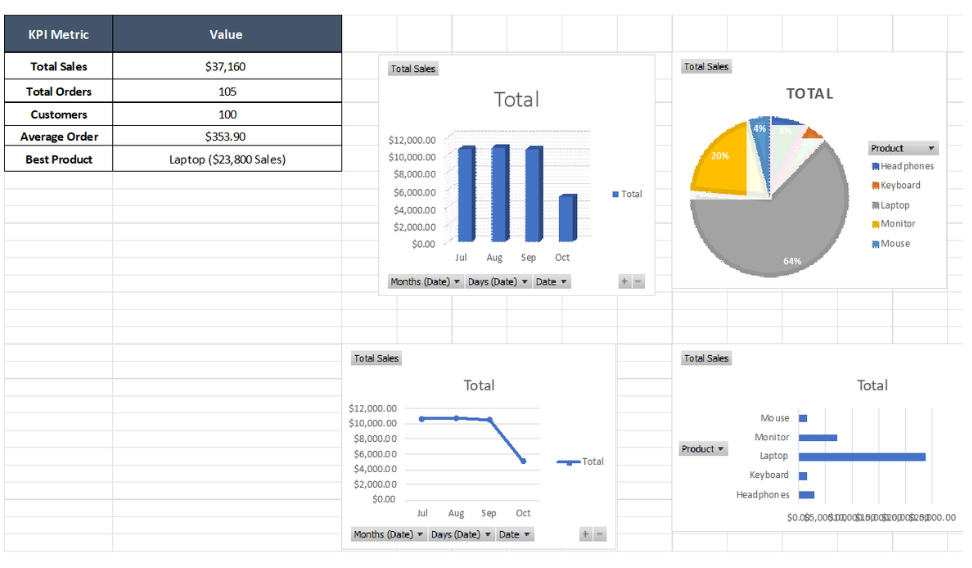

# 📈 Interactive Sales Dashboard Project

This project showcases a professional Sales Dashboard built using Microsoft Excel. It transforms raw sales data into actionable business insights.

## 📊 Dashboard Preview

## 🛠️ Key Features & Tools Used
* **Data Cleaning:** Handled missing values, formatted currency, and structured raw tables.
* **KPI Metrics:** Tracked Total Sales ($37,160), Total Orders, Total Customers, and Top Performing Product.
* **Data Visualization:** Built dynamic Bar, Pie, and Line charts to analyze sales trends and product distributions.
* **Pivot Tables:** Used pivot analytics for efficient backend data processing.

